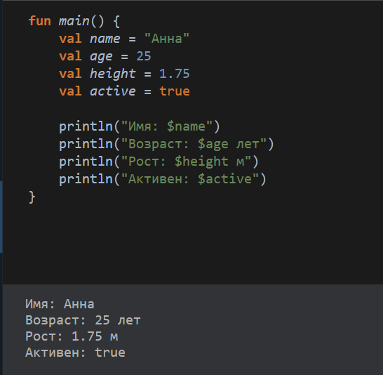
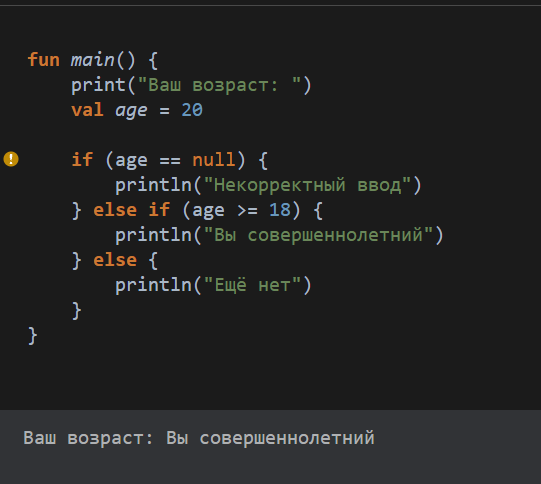
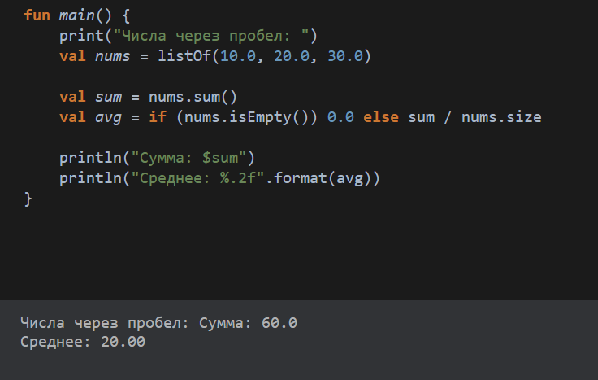

код 1 задания:
  fun main() {
    val name: String = "Анна"
    val age: Int = 25
    val height: Double = 1.75
    val isActive: Boolean = true

    println("Имя: $name")
    println("Возраст: $age лет")
    println("Рост: $height м")
    println("Активен: $isActive")
}

код 2 задания:

  fun main() {
    print("Ширина: ")
    val w = 5.0

    print("Высота: ")
    val h = 3.0

    val area = w * h
    val perimeter = 2 * (w + h)

    println("Площадь: %.2f".format(area))
    println("Периметр: %.2f".format(perimeter))
}

код 3 задания:

  fun main() {
    print("Градусы Цельсия: ")
    val c = 25.0

    // 9 / 5 для Double даст 1.8, всё хорошо.
    // Если бы c был Int, 9/5 == 1 — классическая ошибка.
    val f = c * 9.0 / 5.0 + 32.0
    println("%.1f °C = %.1f °F".format(c, f))
}

код 4 задания:

  fun main() {
    print("Ваш возраст: ")
    val age: Int? = 20

    if (age == null) {
        println("Некорректный ввод")
    } else if (age >= 18) {
        println("Вы совершеннолетний")
    } else {
        println("Ещё нет")
    }
}

код 5 заадния:

  fun main() {
    print("Числа через пробел: ")
    val nums = "10 20 30"
        .trim()
        .split(Regex("\\s+"))
        .map { it.toDouble() }

    val sum = nums.sum()
    val avg = if (nums.isEmpty()) 0.0 else sum / nums.size

    println("Сумма: $sum")
    println("Среднее: %.2f".format(avg))
}

код 6 задания:

  fun main() {
    print("Товар: ")
    val title = "Телефон"

    print("Цена: ")
    val price = 15000.0

    val priceStr = "%.2f ₽".format(price)
    val dots = ".".repeat((30 - title.length - priceStr.length).coerceAtLeast(0))

    println("""
        |$title$dots$priceStr
    """.trimMargin())
}
