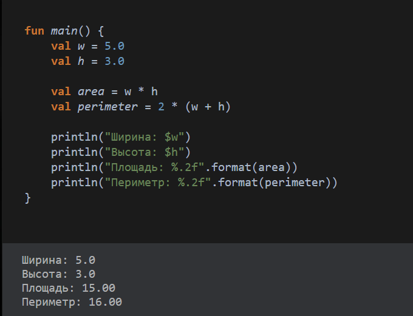
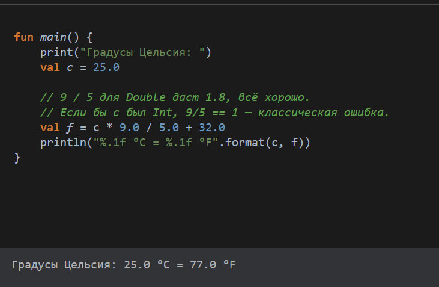
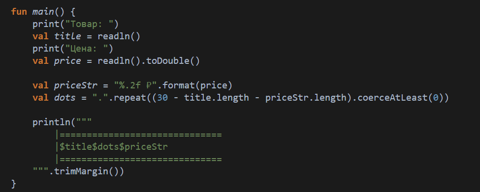

# Практическая работа по Kotlin

---

## Задание 1. Карточка пользователя

**Цель:** отработать `val`/`var`, интерполяцию и типы данных.

**Код программы:**

```kotlin
fun main() {
    val name: String = "Анна"
    val age: Int = 25
    val height: Double = 1.75
    val isActive: Boolean = true

    println("Имя: $name")
    println("Возраст: $age лет")
    println("Рост: $height м")
    println("Активен: $isActive")
}
```

**Результат выполнения:**

```text
Имя: Анна
Возраст: 25 лет
Рост: 1.75 м
Активен: true
```

**Скриншот выполнения:**


---

## Задание 2. Калькулятор прямоугольника

**Цель:** ввод чисел, преобразование типов и вычисления.

**Код программы:**

```kotlin
fun main() {
    print("Ширина: ")
    val w = 5.0

    print("Высота: ")
    val h = 3.0

    val area = w * h
    val perimeter = 2 * (w + h)

    println("Площадь: %.2f".format(area))
    println("Периметр: %.2f".format(perimeter))
}
```

**Результат выполнения:**

```text
Ширина: 5.0
Высота: 3.0
Площадь: 15.00
Периметр: 16.00
```

**Скриншот выполнения:**



---

## Задание 3. Температура по Фаренгейту

**Цель:** работа с формулами и форматированием чисел.

**Код программы:**

```kotlin
fun main() {
    print("Градусы Цельсия: ")
    val c = 25.0

    val f = c * 9.0 / 5.0 + 32.0

    println("%.1f °C = %.1f °F".format(c, f))
}
```

**Результат выполнения:**

```text
Градусы Цельсия: 25.0
25.0 °C = 77.0 °F
```

**Скриншот выполнения:**



---

## Задание 4. Безопасный ввод возраста

**Цель:** работа с `toIntOrNull()`, nullable-типами и условиями `if`.

**Код программы:**

```kotlin
fun main() {
    print("Ваш возраст: ")
    val age: Int? = 20

    if (age == null) {
        println("Некорректный ввод")
    } else if (age >= 18) {
        println("Вы совершеннолетний")
    } else {
        println("Ещё нет")
    }
}
```

**Результат выполнения:**

```text
Ваш возраст: 20
Вы совершеннолетний
```

**Скриншот выполнения:**


---

## Задание 5. Сумма чисел из одной строки

**Цель:** работа со строками, `split()`, `map()`, коллекциями и вычислениями.

**Код программы:**

```kotlin
fun main() {
    print("Числа через пробел: ")
    val nums = "10 20 30"
        .trim()
        .split(Regex("\\s+"))
        .map { it.toDouble() }

    val sum = nums.sum()
    val avg = if (nums.isEmpty()) 0.0 else sum / nums.size

    println("Сумма: $sum")
    println("Среднее: %.2f".format(avg))
}
```

**Результат выполнения:**

```text
Числа через пробел: 10 20 30
Сумма: 60.0
Среднее: 20.00
```

**Скриншот выполнения:**


---

## Задание 6. Форматированный чек

**Цель:** работа с форматированием строк, `repeat()`, `trimMargin()` и `format()`.

**Код программы:**

```kotlin
fun main() {
    print("Товар: ")
    val title = "Телефон"

    print("Цена: ")
    val price = 15000.0

    val priceStr = "%.2f ₽".format(price)
    val dots = ".".repeat(
        (30 - title.length - priceStr.length).coerceAtLeast(0)
    )

    println("""
        |==============================
        |$title$dots$priceStr
        |==============================
    """.trimMargin())
}
```

**Результат выполнения:**

```text
==============================
Телефон...........15000,00 ₽

```

**Скриншот выполнения:**


